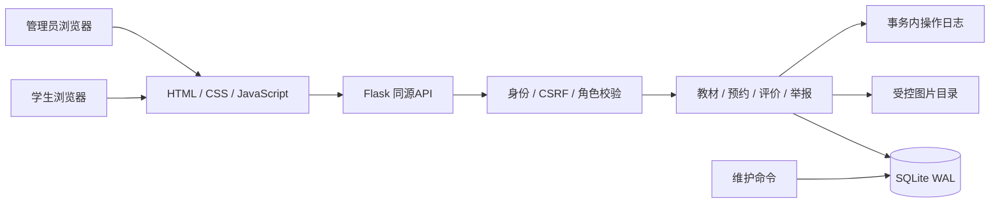
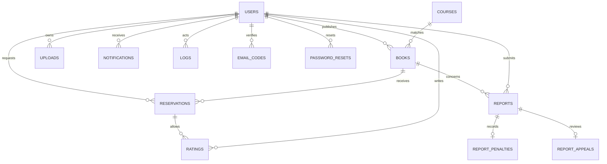
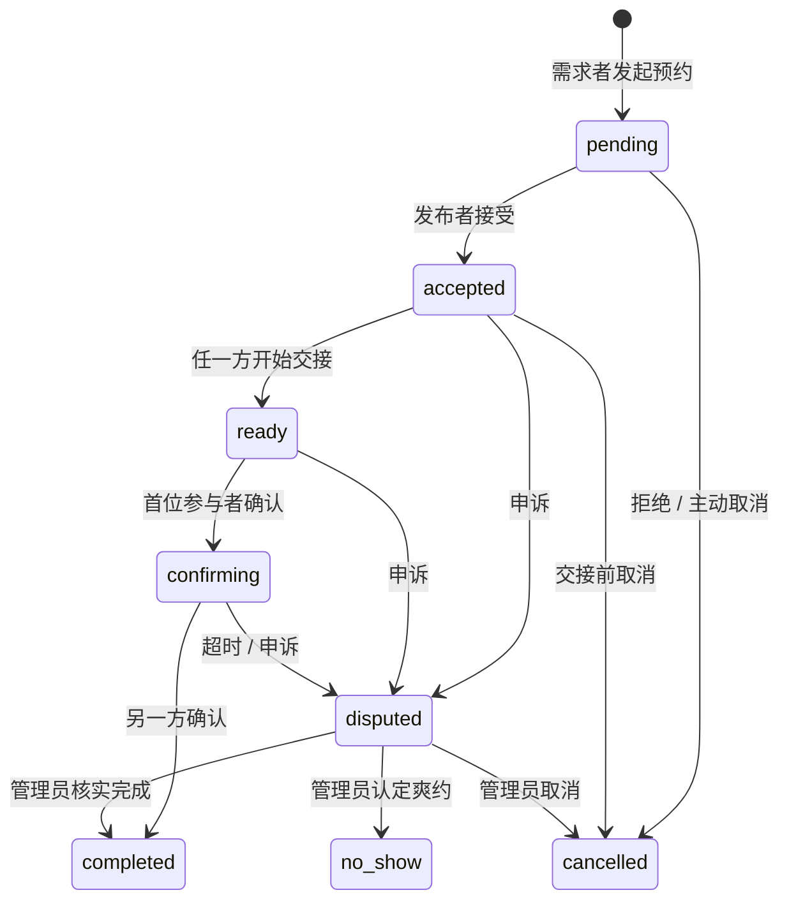

# 系统设计说明

## 1. 技术选择

后端 Flask 3.1、Waitress 3.0，数据库 SQLite WAL，前端原生 JavaScript 与 CSS，图片使用 Pillow 解码重编码。无需 Node 构建步骤或独立数据库服务，降低 Windows 课程演示的安装成本。Node 仅用于可选的前端语法检查。

采用同源 B/S 架构：浏览器通过 `/api` JSON 接口操作后端；后端执行权限校验、数据验证、事务与日志写入。价格以整数分保存，避免浮点计算误差。时间字段中，交接时间使用明确标注的北京时间；审计记录与超时计算使用 UTC。

## 2. 用例与权限

| 主体 | 操作 |
|---|---|
| 访客 | 浏览审核通过教材、查看课程库、注册、登录 |
| 学生 | 发布与管理自己的教材、预约他人教材、操作自己的预约、互评、举报与申诉、个人资料 |
| 管理员 | 审核、举报裁定、交接申诉裁定、统计、课程维护、规则配置、日志查询 |
| 本机维护人员 | 交互创建管理员、数据库备份、批量执行确认超时检查 |

角色以数据库记录为准；注册请求中即使包含 `role=admin` 也不会生效。预约参与人身份在服务端核对，前端隐藏按钮不是权限边界。

## 3. 数据模型

主要字段与约束：

| 表 | 主要字段 | 关键约束 |
|---|---|---|
| users | student_id, password, role, credit, contact, email, auth_version, deleted_at | 学号唯一；密码加盐scrypt；修改密码递增会话版本；非空邮箱唯一；注销为软删除：清空邮箱与联系方式、学号改为 deleted-&lt;id&gt;、在架教材下架，历史记录保留为“已注销用户” |
| courses | code, name, college, textbook | 课程代码主键 |
| books | owner_id, course_code, condition, price, images, status | 外键课程；成色1—5；价格非负整数分 |
| reservations | book_id, buyer_id, status, seller_confirm, buyer_confirm | 活跃状态的book_id部分唯一索引 |
| ratings | reservation_id, author_id, target_id, 三项评分 | 每人每预约仅评价一次；软删除不允许刷评 |
| reports | author_id, book_id, reason, status, resolution | 重复处理由状态前置条件拒绝 |
| report_penalties | report_id, amount, reversed | 保存实际扣分额，一次性撤销 |
| report_appeals | appeal_id, original_id | 同一原举报只允许一轮复核 |
| logs | actor_id, action, entity, entity_id, detail, created_at | 无客户端编辑和删除接口，与业务同事务 |
| settings | key, value | 信用阈值、完成奖励、处罚额、超时小时数 |
| email_codes | user_id, email, code_hash, expires_at | 验证码只存scrypt哈希，10分钟过期，重新获取即作废旧码 |
| password_resets | user_id, token_hash, expires_at, used_at | 只存令牌SHA-256；一次性使用；重置成功递增 auth_version |

结构变更通过 `PRAGMA user_version` 做前向迁移：`migrate()` 在 `schema.sql` 之前执行，为旧库补列，升级后重启为幂等操作。

数据库完整定义以 `schema.sql` 为准。图片以随机文件名储存，教材记录保留1—3个图片路径。

## 4. 交接状态机

`pending`、`accepted`、`ready`、`confirming`、`disputed` 均占用教材预约名额。拒绝、取消、爽约释放名额；完成则将教材标记为已交接。举报成立下架时取消有效预约，逐条记录操作日志。用户不能用重复确认刷信用，管理员不能重复裁定已结单预约。

用户开始交接后不能直接取消，防止一方交书后对方取消记录；需走申诉。主动标记爽约不会立即扣分，必须管理员核实。双方确认超时默认48小时，从首位确认时间开始计算。

## 5. 事务与并发

写请求先执行 `BEGIN IMMEDIATE`，再读取当前状态。状态修改、信用结算、通知和日志在同一事务内提交；校验失败或异常时回滚。SQLite部分唯一索引作为并发最后防线，两个请求同时预约同一本书时仅一个获得201，另一个得到409。

WAL提高读写并行性。数据库连接按请求创建，15秒繁忙超时。该架构适合课程演示规模；多实例高并发生产服务应迁移到PostgreSQL并引入分页、对象存储与独立任务队列。

## 6. 安全与隐私实现

密码由 Werkzeug scrypt 加盐哈希；会话使用随机持久化密钥、HttpOnly、SameSite Cookie和12小时有效期。写请求校验CSRF，存在Origin时检查同源。登录失败按IP和学号计数，10次失败后冻结10分钟。

前端动态文本通过HTML转义输出，后端使用参数化SQL；CSP禁止外部脚本和内联脚本。联系方式不包含在教材公开接口中，只有预约接受后的双方能查看。文本脱敏覆盖常见手机号、邮箱及明确的微信/QQ模式，图片由管理员审核，不能保证自动识别所有图片文字或变体联系方式。

上传校验真实图片内容、JPEG/PNG/WebP格式、5MB大小和解压像素限制；重编码为JPEG，去除原始元数据，限制最大边长1600像素。CSV导出对以公式符号开头的文本加前缀，防止表格公式注入。

## 7. 接口概览

| 模块 | 接口 |
|---|---|
| 身份 | POST /api/register, /login, /logout, /password；GET /api/me；PUT /api/profile |
| 教材 | GET/POST /api/books；GET/PUT /api/books/:id；POST /withdraw, /review；POST /api/uploads |
| 课程 | GET /api/courses；POST /api/admin/courses, /api/admin/courses/import |
| 预约 | POST /api/books/:id/reservations；GET /api/reservations；POST /api/reservations/:id/action, /resolve, /rating |
| 评价 | GET /api/ratings；DELETE /api/ratings/:id |
| 举报 | GET/POST /api/reports；DELETE /api/reports/:id；POST /api/reports/:id/resolve, /appeal |
| 管理 | GET /api/admin/stats, /export, /logs；GET/PUT /api/admin/settings |
| 通知 | GET /api/notifications；POST /api/notifications/read |

200表示成功，201表示创建，400表示校验失败，401表示未登录，403表示权限或CSRF不符，404表示资源不可见，409表示重复或非法状态转换，429表示登录限流。错误响应统一为 `{"error":"中文说明"}`。
